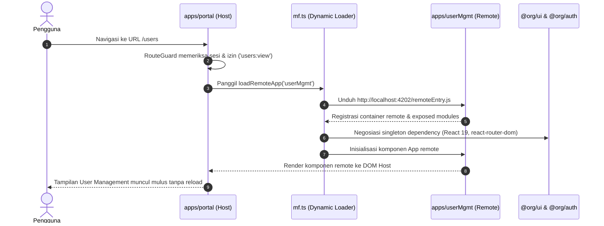
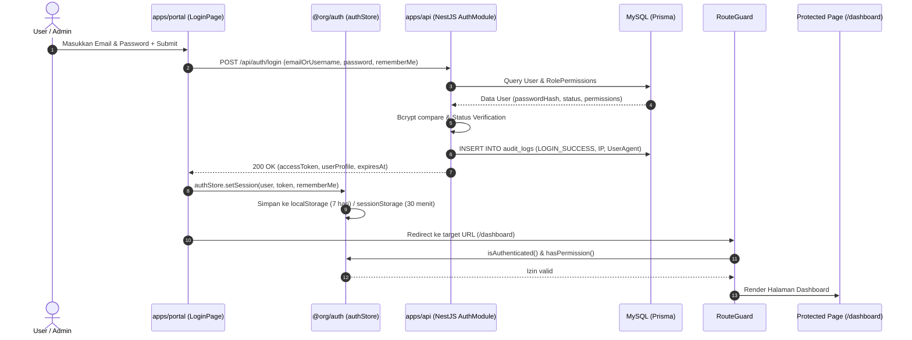
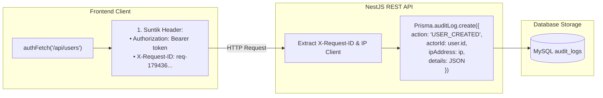

# 03. Arsitektur & Diagram Sistem

Dokumen ini menjelaskan arsitektur tingkat tinggi (*high-level architecture*) dari ekosistem Micro Front-End (MFE) MFC/BGS, protokol komunikasi antar-aplikasi, serta alur otentikasi dan keamanan.

---

## 1. Topologi Arsitektur Sistem

Monorepo ini mengadopsi model **Host-Remote Micro Front-End** yang didukung oleh **Module Federation 2.0** dan paket shared terpusat.

```mermaid
flowchart TD
    subgraph Browser ["Client Web Browser"]
        User["Pengguna / Klien"]
    end

    subgraph HostApp ["Host Application (Port 4200)"]
        Portal["apps/portal (Host Shell)"]
        Router["React Router v6"]
        Guard["RouteGuard & Dev Bypass"]
        MFLoader["Runtime Remote Loader (mf.ts)"]
    end

    subgraph Remotes ["Remote Micro Front-Ends"]
        CompUI["apps/compUI (Port 4201)<br/>Component Showcase & Docs"]
        UserMgmt["apps/userMgmt (Port 4202)<br/>User & Access Management"]
    end

    subgraph SharedLibs ["Shared Packages (Zero Duplication)"]
        SharedUI["@org/ui<br/>(DashShell, PublicLayout, Form Controls)"]
        SharedAuth["@org/auth<br/>(Session Store, RBAC, Can, authFetch)"]
    end

    subgraph BackendSystem ["Backend & Persistence (Port 3000)"]
        NestAPI["apps/api (NestJS REST API)"]
        PrismaORM["Prisma ORM Client"]
        MySQL[(MySQL 8.0 Database)]
        AuditTrail[(Audit Log Records)]
    end

    User --> Portal
    Portal --> Guard
    Guard --> Router
    Router --> MFLoader

    MFLoader -.->|Dynamic HTTP Fetch remoteEntry.js| CompUI
    MFLoader -.->|Dynamic HTTP Fetch remoteEntry.js| UserMgmt

    Portal --> SharedUI
    Portal --> SharedAuth
    CompUI --> SharedUI
    CompUI --> SharedAuth
    UserMgmt --> SharedUI
    UserMgmt --> SharedAuth

    Portal -->|REST API authFetch (Bearer + X-Request-ID)| NestAPI
    UserMgmt -->|REST API authFetch (Bearer + X-Request-ID)| NestAPI
    NestAPI --> PrismaORM
    PrismaORM --> MySQL
    PrismaORM --> AuditTrail
```

---

## 2. Dynamic Runtime Module Federation 2.0

Arsitektur ini **tidak** menggunakan build-time coupling. Sebaliknya, aplikasi Host memuat aplikasi Remote secara **asinkron pada runtime** melalui file `remoteEntry.js`.

### Alur Pemuatan Remote:



### Strategi Shared Dependencies:
Agar tidak terjadi duplikasi bundle React di memori browser, konfigurasi Module Federation menerapkan aturan `singleton: true`:

```ts
shared: {
  react: { singleton: true, requiredVersion: '^19.0.0' },
  'react-dom': { singleton: true, requiredVersion: '^19.0.0' },
  'react-router-dom': { singleton: true, requiredVersion: '^6.30.0' },
}
```

---

## 3. Alur Autentikasi, Keamanan & RBAC Terpusat



---

## 4. Distributed Tracing & Audit Logging

Setiap interaksi antara frontend dan backend dijamin dapat diaudit secara transparan (*enterprise compliance*):



1. **`X-Request-ID`**: Dibuat secara otomatis di client untuk setiap siklus HTTP request dan dapat dilacak pada log server.
2. **`AuditLog Table`**: Mencatat `action` (`LOGIN_SUCCESS`, `LOGIN_FAILED`, `LOGOUT`, `USER_CREATED`, dll.), `entity`, `actorId`, `actorName`, `ipAddress`, dan `createdAt`.
