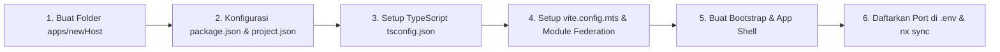

# 04. Panduan Membuat Host Baru (New Host Application)

Dokumen ini memberikan panduan langkah demi langkah (*step-by-step*) untuk membuat aplikasi **Host baru** di dalam monorepo (misalnya: `adminPortal`, `partnerPortal`, atau `mobileWebShell`) dan mengonfigurasinya agar dapat memuat Remote MFE serta memanfaatkan paket shared `@org/ui` dan `@org/auth`.

---

## 1. Alur Pembuatan Host Baru



---

## 2. Langkah 1: Buat Struktur Folder

Buat folder untuk host baru di bawah direktori `apps/`, misalnya `apps/adminPortal`:

```
apps/adminPortal/
├── src/
│   ├── index.css
│   ├── main.tsx
│   ├── bootstrap.tsx
│   ├── App.tsx
│   └── mf.ts
├── index.html
├── package.json
├── project.json
├── tsconfig.json
├── tsconfig.app.json
└── vite.config.mts
```

---

## 3. Langkah 2: Buat `package.json`

Buat file `apps/adminPortal/package.json`:

```json
{
  "name": "admin-portal",
  "version": "0.0.1",
  "private": true,
  "type": "module",
  "dependencies": {
    "@org/ui": "*",
    "@org/auth": "*",
    "react": "^19.0.0",
    "react-dom": "^19.0.0",
    "react-router-dom": "^6.30.0",
    "lucide-react": "^1.70.0"
  }
}
```

---

## 4. Langkah 3: Buat `project.json` (Integrasi Nx)

Buat file `apps/adminPortal/project.json` agar Nx mengenali target `serve`, `build`, dan `test`:

```json
{
  "name": "adminPortal",
  "$schema": "../../node_modules/nx/schemas/project-schema.json",
  "sourceRoot": "apps/adminPortal/src",
  "projectType": "application",
  "targets": {
    "serve": {
      "executor": "@nx/vite:dev-server",
      "defaultConfiguration": "development",
      "options": {
        "buildTarget": "adminPortal:build"
      }
    },
    "build": {
      "executor": "@nx/vite:build",
      "outputs": ["{options.outputPath}"],
      "defaultConfiguration": "production",
      "options": {
        "outputPath": "apps/adminPortal/dist"
      }
    },
    "test": {
      "executor": "@nx/vite:test",
      "outputs": ["{options.reportsDirectory}"],
      "options": {}
    }
  }
}
```

---

## 5. Langkah 4: Setup TypeScript (`tsconfig.json`)

### File `apps/adminPortal/tsconfig.json`:
```json
{
  "extends": "../../tsconfig.base.json",
  "files": [],
  "include": [],
  "references": [
    {
      "path": "./tsconfig.app.json"
    }
  ]
}
```

### File `apps/adminPortal/tsconfig.app.json`:
```json
{
  "extends": "./tsconfig.json",
  "compilerOptions": {
    "outDir": "../../dist/out-tsc",
    "types": ["node", "vite/client"]
  },
  "files": [
    "../../node_modules/@nx/vite/plugins/client.d.ts"
  ],
  "include": [
    "src/**/*.ts",
    "src/**/*.tsx"
  ],
  "references": [
    {
      "path": "../../packages/shared/ui/tsconfig.lib.json"
    },
    {
      "path": "../../packages/shared/auth/tsconfig.lib.json"
    }
  ]
}
```

---

## 6. Langkah 5: Setup `vite.config.mts` (Module Federation Host)

Buat file `apps/adminPortal/vite.config.mts`:

```ts
import { defineConfig } from 'vite';
import react from '@vitejs/plugin-react';
import { federation } from '@module-federation/vite';
import { nxReadySignal } from '@nx/vite/plugins/nx-ready-signal.plugin';
import tailwindcss from '@tailwindcss/vite';
import path from 'node:path';

const PORT = Number(process.env.PORT_ADMIN_PORTAL) || 4205;

export default defineConfig({
  envDir: path.resolve(import.meta.dirname, '../../'),
  envPrefix: ['VITE_', 'userbypass'],
  cacheDir: path.resolve(import.meta.dirname, '../../node_modules/.vite/apps/adminPortal'),
  server: {
    port: PORT,
    strictPort: true,
    host: '0.0.0.0',
    cors: true,
  },
  preview: { port: PORT, strictPort: true },
  build: { target: 'chrome89' },
  resolve: {
    alias: {
      '@org/ui': path.resolve(import.meta.dirname, '../../packages/shared/ui/src/index.ts'),
      '@org/auth': path.resolve(import.meta.dirname, '../../packages/shared/auth/src/index.ts'),
    },
  },
  plugins: [
    federation({
      name: 'adminPortal',
      // Shared libraries yang harus berupa singleton
      shared: {
        react: { singleton: true, requiredVersion: '^19.0.0' },
        'react-dom': { singleton: true, requiredVersion: '^19.0.0' },
        'react-router-dom': { singleton: true, requiredVersion: '^6.30.0' },
      },
    }),
    react(),
    tailwindcss(),
    nxReadySignal(),
  ],
});
```

---

## 7. Langkah 6: Source Code Host

### A. `apps/adminPortal/index.html`
```html
<!DOCTYPE html>
<html lang="id">
  <head>
    <meta charset="UTF-8" />
    <meta name="viewport" content="width=device-width, initial-scale=1.0" />
    <title>Admin Portal - MFC</title>
  </head>
  <body class="bg-slate-50 text-slate-900 antialiased">
    <div id="root"></div>
    <script type="module" src="/src/main.tsx"></script>
  </body>
</html>
```

### B. `apps/adminPortal/src/index.css`
```css
@import "tailwindcss";
```

### C. `apps/adminPortal/src/main.tsx` (Asynchronous Bootstrap)
```tsx
// Sangat penting: Dynamic import bootstrap untuk inisialisasi runtime Module Federation
import('./bootstrap');
```

### D. `apps/adminPortal/src/bootstrap.tsx`
```tsx
import React from 'react';
import ReactDOM from 'react-dom/client';
import { BrowserRouter } from 'react-router-dom';
import App from './App';
import './index.css';

const rootElement = document.getElementById('root');
if (rootElement) {
  const root = ReactDOM.createRoot(rootElement);
  root.render(
    <React.StrictMode>
      <BrowserRouter>
        <App />
      </BrowserRouter>
    </React.StrictMode>
  );
}
```

### E. `apps/adminPortal/src/mf.ts` (Dynamic Remote Loader)
```tsx
import React, { lazy } from 'react';
import { init, loadRemote } from '@module-federation/runtime';

let isInitialized = false;

export function initRemotes() {
  if (isInitialized) return;

  const compUiUrl = import.meta.env.VITE_COMP_UI_URL || 'http://localhost:4201/remoteEntry.js';
  const userMgmtUrl = import.meta.env.VITE_USER_MGMT_URL || 'http://localhost:4202/remoteEntry.js';

  init({
    name: 'adminPortal',
    remotes: [
      { name: 'compUI', entry: compUiUrl },
      { name: 'userMgmt', entry: userMgmtUrl },
    ],
  });

  isInitialized = true;
}

export const RemoteCompUI = lazy(async () => {
  initRemotes();
  try {
    const mod = await loadRemote<{ default: React.ComponentType }>('compUI/App');
    return mod || { default: () => <div>Remote CompUI tidak ditemukan</div> };
  } catch (err) {
    return { default: () => <div className="p-6 text-rose-600">Gagal memuat Remote CompUI</div> };
  }
});

export const RemoteUserMgmt = lazy(async () => {
  initRemotes();
  try {
    const mod = await loadRemote<{ default: React.ComponentType }>('userMgmt/App');
    return mod || { default: () => <div>Remote UserMgmt tidak ditemukan</div> };
  } catch (err) {
    return { default: () => <div className="p-6 text-rose-600">Gagal memuat Remote User Management</div> };
  }
});
```

### F. `apps/adminPortal/src/App.tsx`
```tsx
import React, { Suspense } from 'react';
import { Routes, Route, Link } from 'react-router-dom';
import { RouteGuard } from '@org/auth';
import { RemoteCompUI, RemoteUserMgmt } from './mf';

export default function App() {
  return (
    <div className="min-h-screen flex flex-col bg-slate-50">
      <header className="bg-slate-900 text-white px-6 py-4 flex items-center justify-between">
        <h1 className="font-bold text-lg">MFC Admin Portal</h1>
        <nav className="flex gap-4 text-sm font-medium">
          <Link to="/" className="hover:text-blue-400">Dashboard</Link>
          <Link to="/components" className="hover:text-blue-400">Komponen UI</Link>
          <Link to="/users" className="hover:text-blue-400">Manajemen Pengguna</Link>
        </nav>
      </header>

      <main className="flex-1 p-6">
        <Suspense fallback={<div className="p-8 text-center text-slate-500">Memuat Micro Front-End...</div>}>
          <Routes>
            <Route path="/" element={<div>Selamat datang di Admin Portal</div>} />
            <Route
              path="/components/*"
              element={
                <RouteGuard requiredPermissions={['components:view']}>
                  <RemoteCompUI />
                </RouteGuard>
              }
            />
            <Route
              path="/users/*"
              element={
                <RouteGuard requiredRole="Administrator">
                  <RemoteUserMgmt />
                </RouteGuard>
              }
            />
          </Routes>
        </Suspense>
      </main>
    </div>
  );
}
```

---

## 8. Langkah 7: Sinkronisasi dan Uji Coba

1. Daftarkan port baru di `.env` dan `.env.example`:
   ```bash
   PORT_ADMIN_PORTAL=4205
   ```
2. Jalankan perintah sinkronisasi referensi TypeScript Nx:
   ```bash
   npx nx sync
   ```
3. Uji coba jalankan server host baru:
   ```bash
   npx nx run adminPortal:serve
   ```
4. Uji coba build produksi host baru:
   ```bash
   npx nx run adminPortal:build
   ```

Aplikasi host baru Anda kini siap beroperasi dan terintegrasi penuh dengan seluruh ekosistem Micro Front-End!
